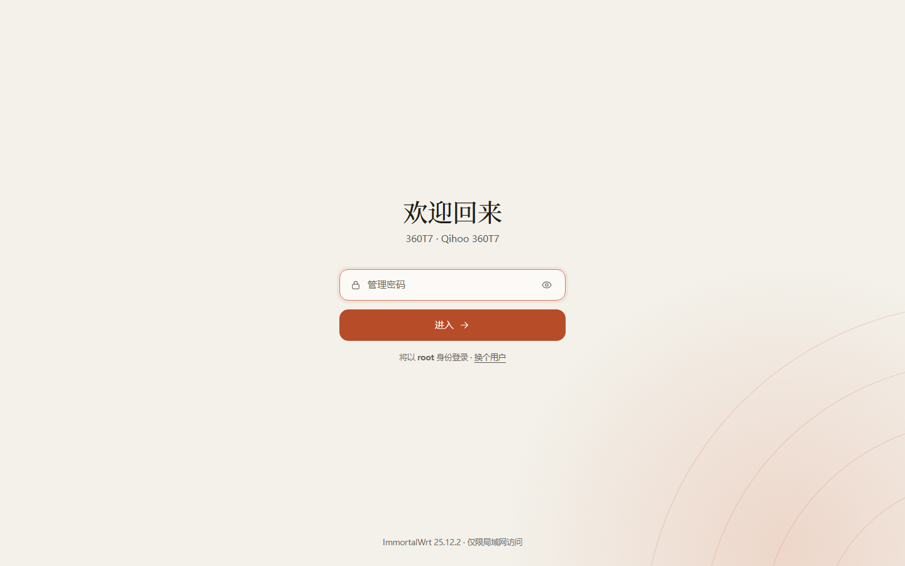
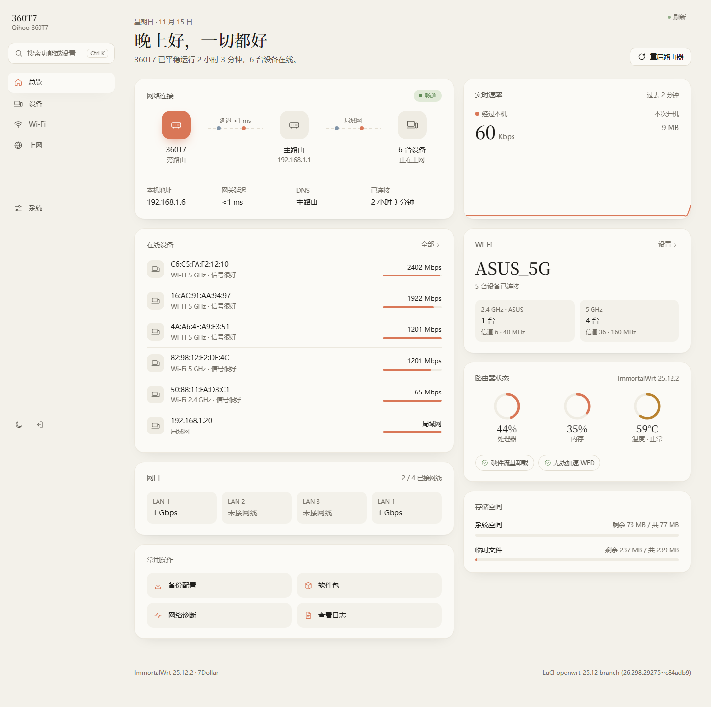
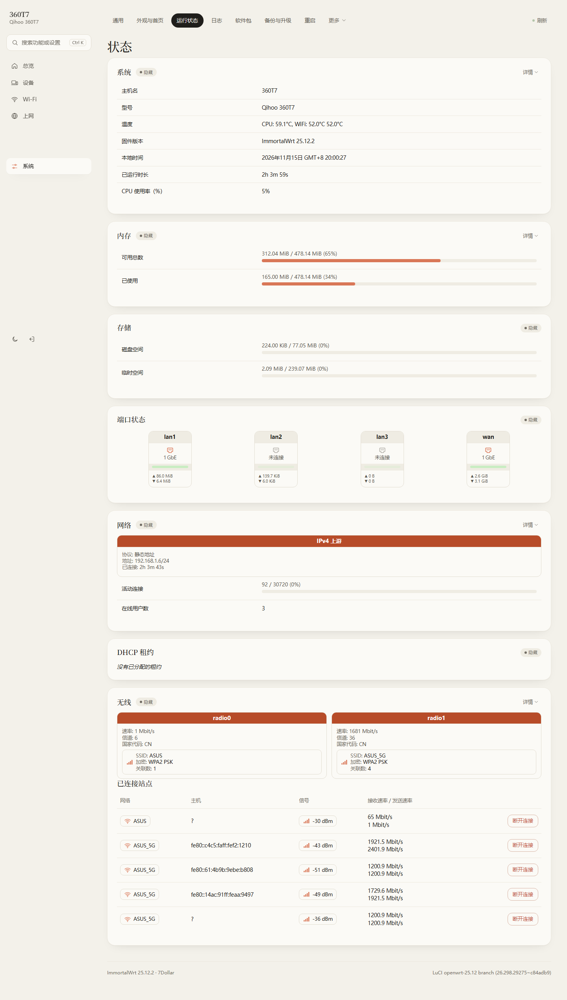
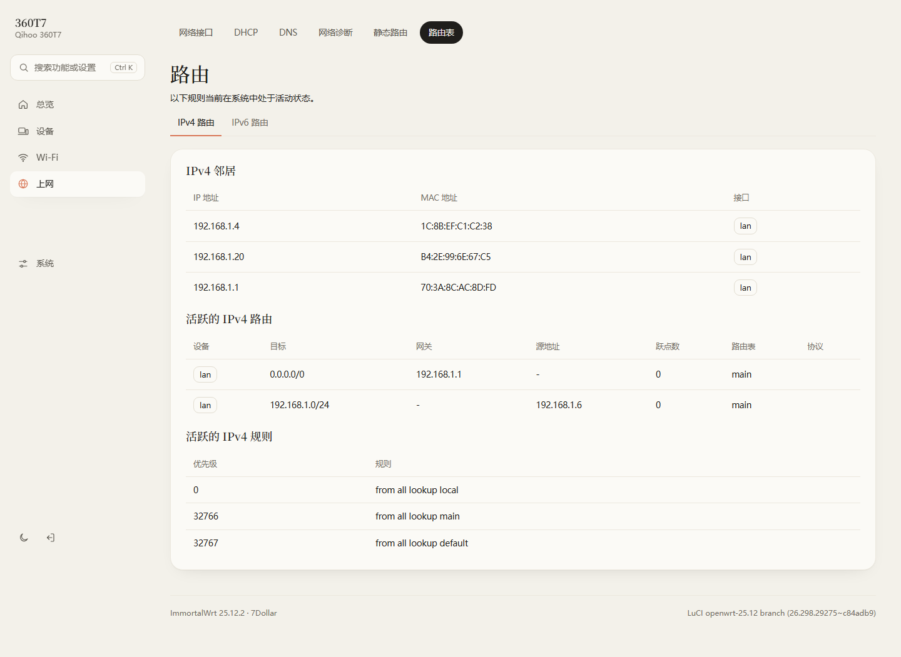
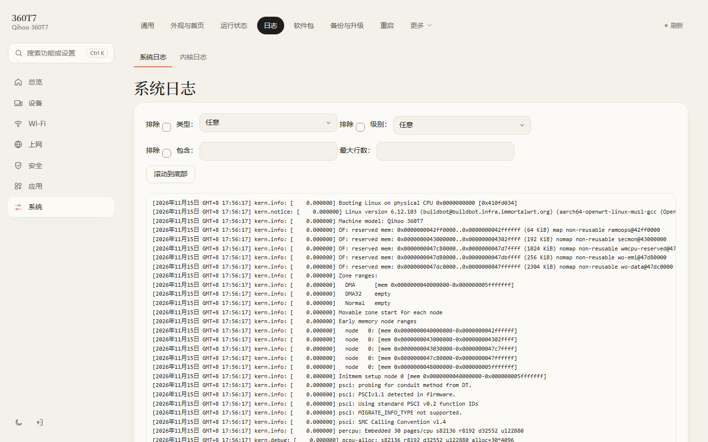
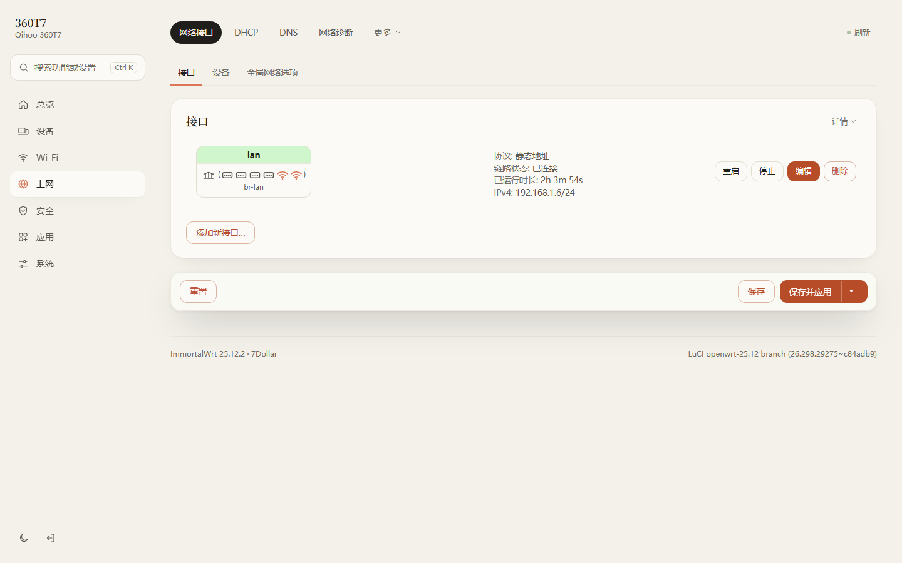
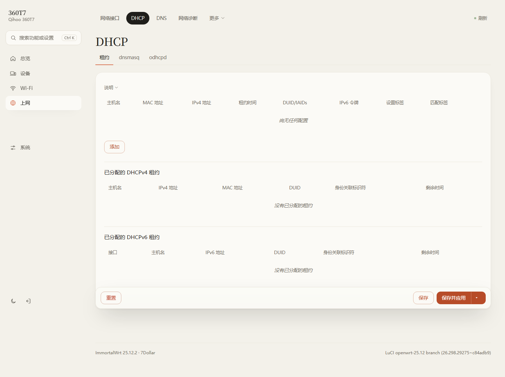
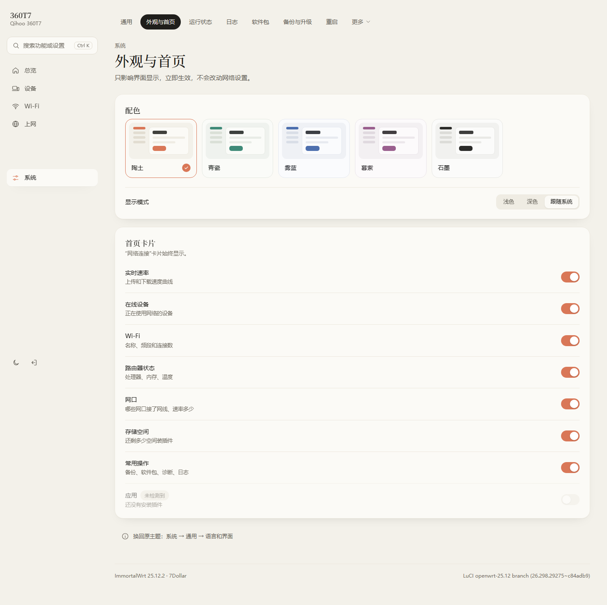
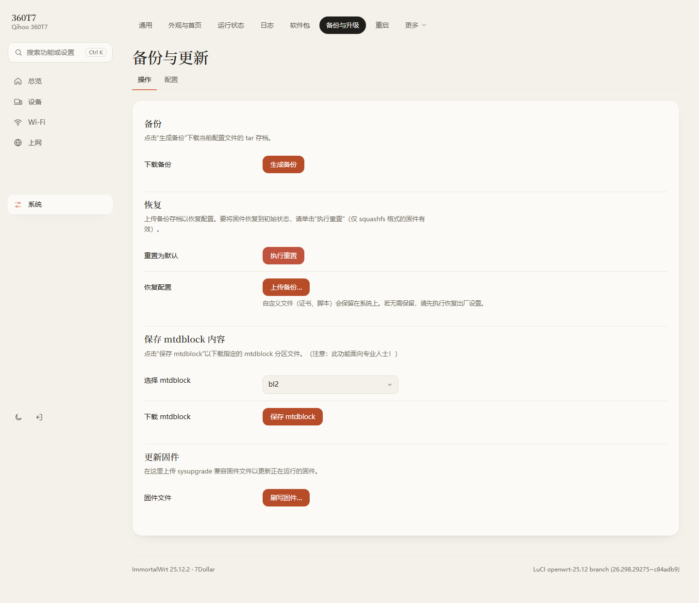

# 360T7 ImmortalWrt 25.12 固件构建

基于 GitHub Actions 与 ImmortalWrt 官方 ImageBuilder，为 **Qihoo 360 T7** 自动构建固件。


## 简介

本仓库使用 ImmortalWrt 官方提供的 ImageBuilder 预编译环境完成打包，不进行源码编译，单次构建即可产出可刷写的固件镜像。固件仅包含 ImmortalWrt 官方软件源中的默认软件包，不集成第三方插件。

- 上游版本：**ImmortalWrt 25.12.2**
- 上游分支：[`immortalwrt/immortalwrt @ openwrt-25.12`](https://github.com/immortalwrt/immortalwrt/tree/openwrt-25.12)
- 目标平台：`mediatek/filogic`（`aarch64_cortex-a53`）
- LuCI 主题：默认 [7Dollar](https://github.com/itsmaiGe/luci-theme-7dollar)，保留官方 Bootstrap 供切换

> ImmortalWrt 25.12 起软件包格式由 `.ipk` 变更为 `.apk`。本仓库不使用 IPK 插件链，也不引入任何第三方软件源。

## 特性

| 特性 | 说明 |
| --- | --- |
| 官方 ImageBuilder 打包 | 直接使用上游预编译环境，构建耗时短、结果可复现 |
| 双 Flash 布局 | 一次构建同时产出非 UBI 与 UBI 两种布局，发布至同一个 Release |
| 官方默认包 | 不集成第三方插件，仅保留 LuCI 主题 |
| 主题构建期注入 | 7Dollar 在构建时从上游 Release 拉取最新版，仓库内不存放第三方二进制 |
| 完整性校验 | 下载 ImageBuilder 后校验上游 `sha256sums` |
| 构建缓存 | 通过 `actions/cache` 复用已解压的 ImageBuilder |
| 自动发布 | 构建完成后自动清理同名旧 Release 并上传新资产 |
| 定时构建 | 每周自动构建一次，与上游同步 |

## 界面预览

LuCI 界面基于 7Dollar 主题。

### 登录与首页

| 登录页 | 首页仪表盘 |
| :---: | :---: |
|  |  |

### 状态信息

| 状态总览 | 已连接客户端 |
| :---: | :---: |
|  |  |

| 应用概览 | 路由表 |
| :---: | :---: |
|  |  |

| 系统日志 |
| :---: |
|  |

### 网络配置

| 无线配置 | 网络接口 |
| :---: | :---: |
|  |  |

| 防火墙 | DHCP / DNS |
| :---: | :---: |
|  |  |

### 系统管理

| 主题外观 | 系统设置 |
| :---: | :---: |
|  |  |

| 软件包 | 刷写固件 |
| :---: | :---: |
|  |  |

## 目录结构

```text
.
├── .github/
│   └── workflows/
│       └── build-openwrt-image.yml   # 构建工作流
├── build/
│   └── qihoo_360t7/                  # 设备配置
│       ├── config.sh                 # 非 UBI 布局配置（兼作公共参数基准）
│       ├── config_ubi.sh             # UBI 布局配置
│       ├── packages.sh               # 设备级软件包
│       └── 99-custom.sh              # 首次启动初始化脚本
├── config/
│   └── default_packages.sh           # 全局软件包（保持为空）
├── docs/
│   └── images/                       # 界面截图
├── .gitattributes                    # 统一使用 LF 换行
└── README.md
```

| 文件 | 说明 |
| --- | --- |
| `build-openwrt-image.yml` | 下载并校验 ImageBuilder、注入主题包、构建两种布局、发布 Release |
| `config.sh` | 定义 `hostname`、`profile`、`targets`、`arch`、`version`、`ip_address`、`netmask` |
| `config_ubi.sh` | 与 `config.sh` 一致，仅 `profile` 为 `qihoo_360t7-ubi` |
| `packages.sh` | 在官方默认包之外追加主题包 |
| `99-custom.sh` | 首次启动时写入主机名、LAN 地址、SSH 监听范围、默认主题与固件描述 |
| `default_packages.sh` | 全局包列表，留空以使用 profile 默认包 |

## 构建

### 触发方式

| 方式 | 说明 |
| --- | --- |
| 手动触发 | Actions → `Build OpenWrt Image (qihoo_360t7)` → Run workflow，可选填 `ip_address` |
| 定时触发 | 每周五 00:00 UTC（北京时间 08:00），cron `0 0 * * 5` |

向仓库推送代码不会触发构建，需在 Actions 页面手动触发或等待定时任务。

### 构建流程

1. 读取 `build/qihoo_360t7/config.sh` 中的公共参数，手动触发时可用 `ip_address` 覆盖管理地址
2. 从 `downloads.immortalwrt.org` 获取 `sha256sums`，解析 ImageBuilder 归档名与校验值
3. 校验下载归档后解压到 `imagebuilder/`，并通过 `actions/cache` 缓存（缓存键包含版本与归档 sha256）
4. 读取 7Dollar 上游 `dist/latest-apk.txt`，解析当前 25.x 适用的 apk 文件名与版本号，从对应 GitHub Release 下载（失败时回退上游仓库内 `dist/`），放入 `imagebuilder/packages/`
5. 合并 `default_packages.sh` 与 `packages.sh` 得到最终 `PACKAGES`
6. 复制 `99-custom.sh` 至 `imagebuilder/files/etc/uci-defaults/`，注入主机名、IP 与掩码
7. 依次执行两次 `make image`：`PROFILE="qihoo_360t7"` 与 `PROFILE="qihoo_360t7-ubi"`
8. 每次构建后校验 `.manifest` 是否包含主题包，并将产物归档至 `artifacts/<profile>/`
9. 清理构建产物、保存缓存
10. 删除同名旧 Release 与 Tag，将两个布局的全部资产发布至同一 Release

### 主题包注入说明

ImageBuilder 执行 `make image` 时会对其 `packages/` 目录运行 `apk mkndx` 生成 `packages.adb` 索引，并通过 `--repository` 纳入安装源。因此只需将上游 apk 放入该目录并在 `PACKAGES` 中声明包名即可完成集成，无需把第三方二进制提交到本仓库。

ImageBuilder 以 `--no-scripts` 方式安装软件包，主题自带的 post-install 脚本不会执行，默认主题的切换由 `99-custom.sh` 在首次启动时通过 `uci set luci.main.mediaurlbase` 完成。

### Release 产物

Release Tag 固定为 `25.12-qihoo_360t7`，资产文件名已去除 `immortalwrt-` 前缀与 `mediatek-filogic-` 架构段。

| 非 UBI 布局 | UBI 布局 |
| --- | --- |
| `25.12.2-qihoo_360t7-squashfs-sysupgrade.itb` | `25.12.2-qihoo_360t7-ubi-squashfs-sysupgrade.itb` |
| `25.12.2-qihoo_360t7-initramfs-recovery.itb` | `25.12.2-qihoo_360t7-ubi-initramfs-recovery.itb` |
| `25.12.2-qihoo_360t7-bl31-uboot.fip` | `25.12.2-qihoo_360t7-ubi-bl31-uboot.fip` |
| `25.12.2-qihoo_360t7-preloader.bin` | `25.12.2-qihoo_360t7-ubi-preloader.bin` |
| `25.12.2-qihoo_360t7.manifest` | `25.12.2-qihoo_360t7-ubi.manifest` |
| `sha256sums-qihoo_360t7` | `sha256sums-qihoo_360t7-ubi` |

`sha256sums` 附加 profile 后缀，避免两种布局的文件在同一 Release 中重名覆盖。

## 固件说明

### 默认配置

以下配置由 `99-custom.sh` 在首次启动时写入。

| 项目 | 默认值 | 对应配置项 |
| --- | --- | --- |
| 主机名 | `360T7` | `system.@system[0].hostname` |
| LAN 地址 | `192.168.10.1` | `network.lan.ipaddr` |
| 子网掩码 | `255.255.255.0` | `network.lan.netmask` |
| SSH 监听 | 所有接口 | `dropbear.@dropbear[0].Interface=''` |
| LuCI 主题 | `/luci-static/7dollar` | `luci.main.mediaurlbase` |
| 固件描述 | `By zsyn666` | `/etc/openwrt_release` 的 `DISTRIB_DESCRIPTION` |

### 软件包

`default_packages.sh` 保持为空，基础功能由官方默认包与设备 profile 提供：

| 类别 | 组件 |
| --- | --- |
| Web 管理界面 | `luci`、`luci-base`、`luci-mod-*`、`luci-theme-bootstrap`、`uhttpd` |
| 中文本地化 | `luci-i18n-*-zh-cn` |
| 拨号与地址分配 | `ppp`、`ppp-mod-pppoe`、`dnsmasq-full`、`odhcp6c`、`odhcpd-ipv6only` |
| 防火墙与 NAT | `firewall4`、`nftables-json`、`kmod-nft-*` |
| 网络加速 | `kmod-nf-flow`、`kmod-nft-offload`、`kmod-nft-fullcone` |
| 无线 | `wpad-openssl`、`hostapd-common` |
| 硬件驱动 | `kmod-mt7915e`、`kmod-mt7981-firmware`、`mt7981-wo-firmware` |

### 网络加速

固件使用 ImmortalWrt 官方的 flow offloading / flowtable 实现转发加速，相关内核模块由官方默认包提供，防火墙默认配置如下：

```
firewall.@defaults[0].flow_offloading='1'
firewall.@defaults[0].flow_offloading_hw='1'
firewall.@defaults[0].fullcone='1'
```

LuCI 中的「Turbo ACC 网络加速」页面由第三方软件包 `luci-app-turboacc` 提供，不属于 ImmortalWrt 25.12 官方软件源，本固件未集成该页面；上述转发加速能力无需该页面即可生效。

## 安装指南

### 前置条件

#### 分区布局

固件按 Flash 分区布局分为两套，镜像不可混用，刷写前必须确认设备当前的布局。

| 布局 | 适用条件 | 文件名特征 |
| --- | --- | --- |
| 非 UBI | 原厂分区表，或使用 `kernel` / `rootfs` 分区的 U-Boot | `25.12.2-qihoo_360t7-*` |
| UBI | 已刷入 UBI 布局 U-Boot，使用单个 `fit` UBI 卷 | `25.12.2-qihoo_360t7-ubi-*` |

UBI 布局下的分区表与卷结构如下，可执行 `cat /proc/mtd` 与 `ubinfo -a` 比对：

```
dev:    size      erasesize  name
mtd0:  00100000  00020000  "bl2"
mtd1:  00080000  00020000  "u-boot-env"
mtd2:  00200000  00020000  "Factory"
mtd3:  00200000  00020000  "fip"
mtd4:  06c00000  00020000  "ubi"          # 108 MiB
mtd5:  00100000  00020000  "config"
mtd6:  00080000  00020000  "factory"
mtd7:  00700000  00020000  "log"

ubi0 volume 0: "fit"          132 LEBs (15.9 MiB)
ubi0 volume 1: "rootfs_data"  706 LEBs (85.4 MiB)
LEB size: 126976 字节
```

#### U-Boot 版本

通过 U-Boot WebUI 引导 initramfs 救援系统，需要一个**带 WebUI 恢复页的 U-Boot**。

| U-Boot | 版本字符串 | WebUI 恢复页 |
| --- | --- | --- |
| hanwckf 第三方 U-Boot | `U-Boot 2023.07` | 支持，提供 `/initramfs.html`、`/upload`、`/getmtdlayout` 等路由 |
| 原厂 U-Boot | `U-Boot 2022.07-rc3` | 支持，提供 failsafe WebUI |
| 本 Release 内 `*-bl31-uboot.fip` | `U-Boot 2025.10-ImmortalWrt` | **不支持**，官方 U-Boot 未编译 WebUI 恢复页 |

> Release 中的 `*-bl31-uboot.fip` 为官方 U-Boot，不含 WebUI 恢复页。刷入后若系统损坏，将无法通过 WebUI 上传 initramfs 镜像救援，请确保保留其它可用的恢复手段。

#### 工具与备份

- 网线一根，用于连接设备 LAN 口与电脑
- 支持现代 HTML5 的浏览器（Chrome / Edge / Firefox）
- SSH 客户端（OpenSSH 或 PuTTY）
- 建议使用 `sha256sums-<profile>` 校验下载的镜像

刷写前建议备份分区与配置：

```sh
for m in /dev/mtd0 /dev/mtd1 /dev/mtd2 /dev/mtd3 /dev/mtd4; do
    dd if=$m of=/tmp/$(basename $m).bin bs=64k
done
sysupgrade -b /tmp/backup.tar.gz
```

### 方式一：系统内升级

适用于已能进入 LuCI 或 SSH 的设备。

1. 下载与当前布局匹配的 `*-squashfs-sysupgrade.itb` 并校验
2. 通过 LuCI **系统 → 刷写固件**上传，或将镜像传入设备 `/tmp/` 后执行：

   ```sh
   sysupgrade -n /tmp/<镜像名>.itb      # 不保留配置
   sysupgrade    /tmp/<镜像名>.itb      # 保留配置
   ```

3. 设备自动重启，首次启动时执行 `99-custom.sh` 写入默认配置

> 跨大版本升级时（例如自 ImmortalWrt 18.06 升级），旧配置使用了 swconfig 与 MTK 私有无线驱动，而 25.12 使用 DSA 与 mac80211，配置格式不兼容，建议不保留配置。

### 方式二：U-Boot WebUI 引导 initramfs 安装

适用于裸机安装或系统无法启动的情况。

ImmortalWrt 25.12 的 `sysupgrade.itb` 是带外部数据的 FIT 镜像，FIT 头中的 `totalsize` 仅描述头部（4096 字节），完整镜像约 16.6 MiB。U-Boot WebUI 依据该字段校验时会判定镜像异常并返回 `UPDATE FAILED`，因此不能直接通过 WebUI 刷写 `sysupgrade.itb`，需经由 initramfs 系统在内存中完成安装。

#### 1. 进入 U-Boot WebUI

1. 将电脑网卡设为静态地址 `192.168.1.2`，掩码 `255.255.255.0`
2. 设备断电，按住 RESET 键通电，持续按住约 5–10 秒后松开
3. 浏览器访问 `http://192.168.1.1`

> 若局域网内已存在 `192.168.1.1` 的设备，请先断开该网络，避免访问到其它设备的管理页面。

#### 2. 引导 initramfs 系统

1. 访问 `http://192.168.1.1/initramfs.html`
2. 选择与布局匹配的 `*-initramfs-recovery.itb` 并上传
3. 等待设备启动至内存中的 initramfs 系统。此阶段不写入 Flash

#### 3. 写入固件

initramfs 系统的外网访问能力有限，建议在同一局域网内通过 HTTP 传输镜像。

```sh
# 提供镜像的机器上，于镜像所在目录执行
python3 -m http.server 8899 --bind 0.0.0.0
```

```sh
# 设备上执行，<HOST> 为提供镜像的机器地址
cd /tmp
uclient-fetch -O fw.itb http://<HOST>:8899/<镜像名>.itb
sysupgrade -T /tmp/fw.itb      # 预校验，应输出 Signature check OK
sysupgrade -n /tmp/fw.itb      # 写入 Flash 并重启
```

系统会自动建立所需的 UBI 卷（`fit` 与 `rootfs_data`）并重启进入新固件。

#### 4. 首次登录

- 访问 `http://192.168.10.1`（或构建时指定的 `ip_address`）
- 初始 root 密码为空，登录后请立即设置

### 仅更新 Bootloader

Release 中的 `*-bl31-uboot.fip` 与 `*-preloader.bin` 用于更换 bootloader，不是系统镜像。刷写属于高风险操作，请确认布局匹配并保留可用的恢复手段。

## 自定义

### 更新上游版本

同时修改 `build/qihoo_360t7/config.sh` 与 `config_ubi.sh` 中的 `version`，两处保持一致。确认上游存在对应归档：

```
https://downloads.immortalwrt.org/releases/<version>/targets/mediatek/filogic/
  immortalwrt-imagebuilder-<version>-mediatek-filogic.Linux-x86_64.tar.zst
```

profile 名称可通过 ImageBuilder 的 `make info` 或上游 `profiles.json` 核对，当前为 `qihoo_360t7` 与 `qihoo_360t7-ubi`。

### 增删软件包

在 `build/qihoo_360t7/packages.sh` 中追加官方源内存在的包名（`.apk` 格式）：

```bash
PACKAGES="$PACKAGES iperf3"
```

### 修改默认配置

编辑 `build/qihoo_360t7/99-custom.sh`，该脚本在首次启动时执行一次，之后由系统清理。主机名、IP 与掩码由工作流在构建时注入，无需手工修改。

## 常见问题

| 现象 | 排查方向 |
| --- | --- |
| ImageBuilder 下载 404 | 两份 `config*.sh` 的 `version` 与上游发布版本号不一致 |
| `sha256sum -c` 失败 | 上游归档已更新，清除 Actions 缓存后重试 |
| 构建提示 PROFILE 不存在 | 使用 `make info` 核对 profile 名称 |
| 主题仍为 Bootstrap | 检查 `99-custom.sh` 是否执行、apk 是否成功安装，查看构建日志中的 `Installing packages` |
| 主题 apk 下载失败 | 上游 Release 缺少对应 tag，工作流会自动回退至仓库内 `dist/` |
| U-Boot WebUI 报 `UPDATE FAILED` | 直接上传了 `sysupgrade.itb`，请按「方式二」经 initramfs 安装 |
| 无法访问 U-Boot WebUI | 确认 U-Boot 带 WebUI 恢复页，且局域网内无 `192.168.1.1` 冲突 |
| 刷机后管理地址不符 | 固件默认为 `192.168.10.1`，可在构建时通过 `ip_address` 指定 |
| 找不到 Turbo ACC 菜单 | 该页面由第三方软件包提供，本固件未集成，详见「网络加速」 |

## 致谢

- [ImmortalWrt](https://github.com/immortalwrt/immortalwrt) —— 提供 ImageBuilder 与软件源
- [luci-theme-7dollar](https://github.com/itsmaiGe/luci-theme-7dollar) —— LuCI 主题
- [hanwckf/bl-mt798x](https://github.com/hanwckf/bl-mt798x) —— MT798x 系列 bootloader

## 免责声明

本仓库仅提供固件构建流程。刷写固件与 bootloader 存在设备无法启动的风险，请在操作前完整备份分区与配置，并确认已掌握对应的恢复方法。因使用本仓库产物造成的任何损失，作者不承担责任。
