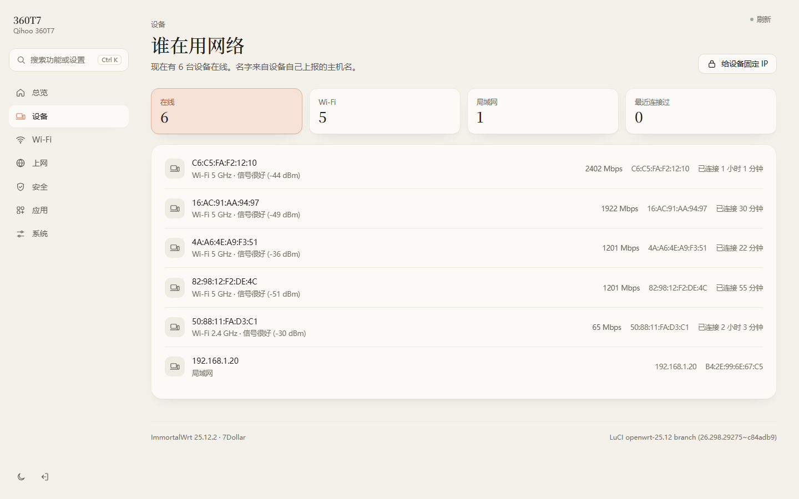
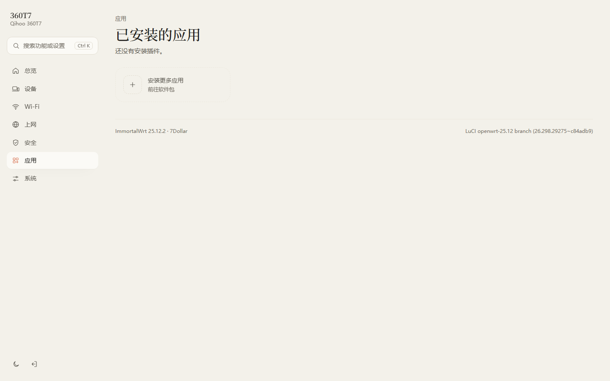
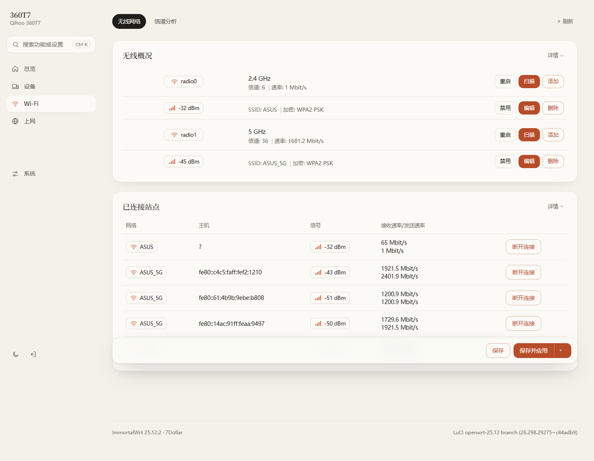
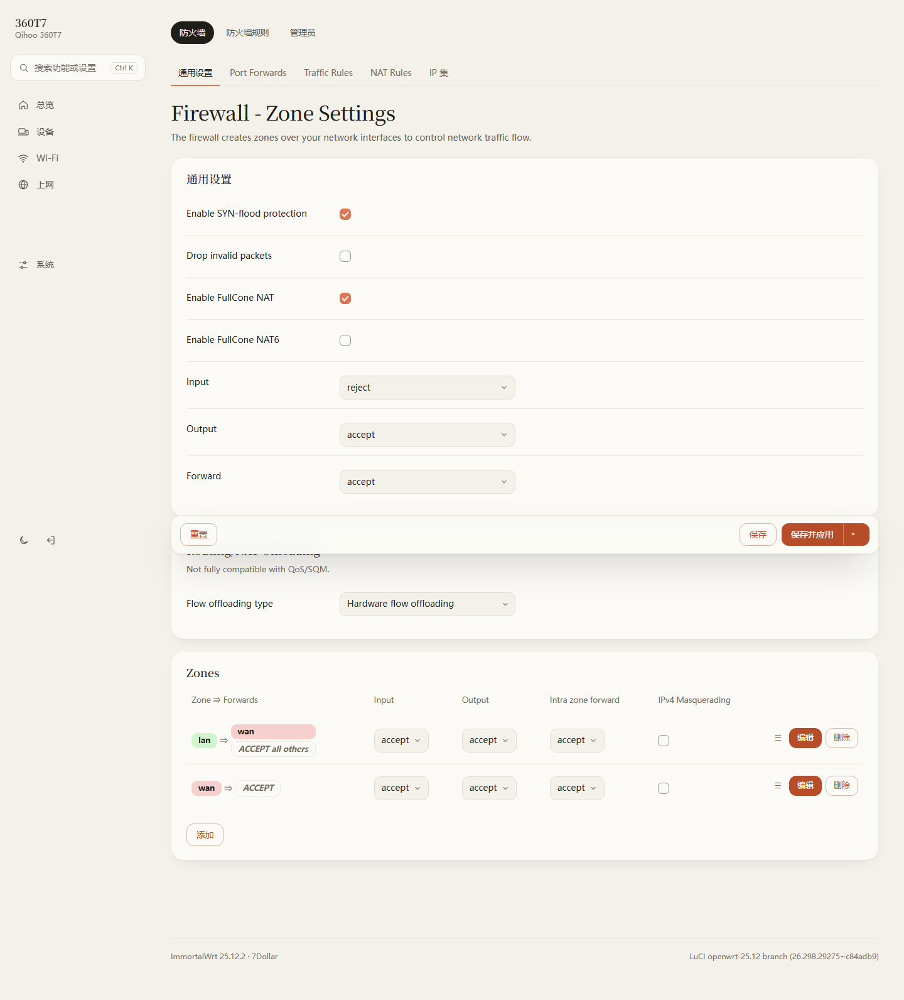
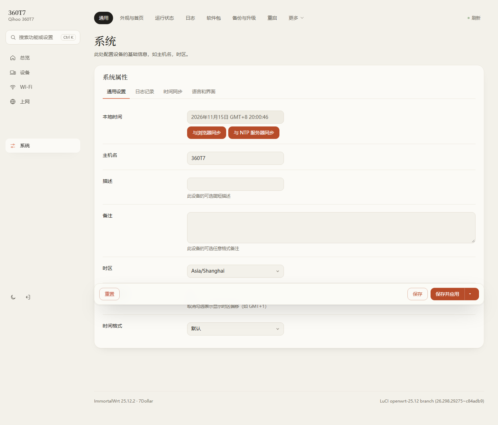
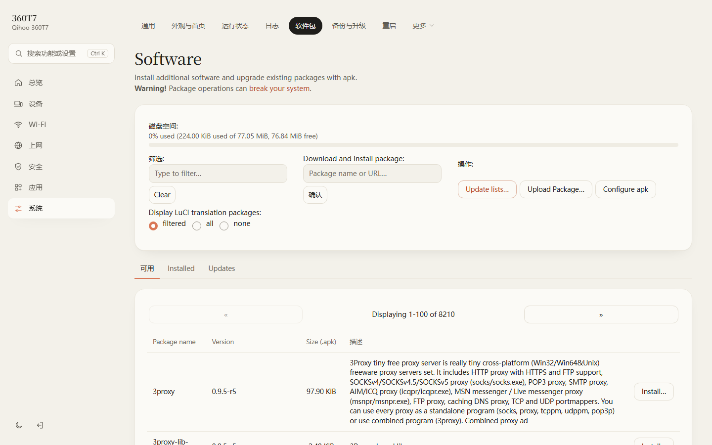

# 360T7 ImmortalWrt 25.12 固件自动化构建

本仓库使用 GitHub Actions 与 ImmortalWrt 官方 ImageBuilder，为 **Qihoo 360 T7**（`mediatek/filogic`）自动化构建固件。

- 基础版本：**ImmortalWrt 25.12.2**，对应源码分支 [`immortalwrt/immortalwrt @ openwrt-25.12`](https://github.com/immortalwrt/immortalwrt/tree/openwrt-25.12)
- 软件包：仅使用官方源默认包，不集成第三方插件
- LuCI 主题：默认 [7Dollar](https://github.com/itsmaiGe/luci-theme-7dollar)，保留官方 `luci-theme-bootstrap` 作为可切换选项
- 产物：每次构建同时输出**非 UBI 布局**与 **UBI 布局**两套镜像，发布至同一个 Release

> ImmortalWrt 25.12 起，软件包格式由 `.ipk` 变更为 `.apk`。本仓库不使用旧版 IPK 插件链，也不引入第三方软件源。

---

## 目录

- [界面预览](#界面预览)
- [仓库结构](#仓库结构)
- [构建流程](#构建流程)
- [固件定制项](#固件定制项)
- [网络功能说明](#网络功能说明)
- [安装前置依赖](#安装前置依赖)
- [安装流程](#安装流程)
- [配置与维护](#配置与维护)
- [常见问题](#常见问题)

---

## 界面预览

以下截图取自运行本仓库固件的 360 T7 实机，系统版本 ImmortalWrt 25.12.2（`r38135-0c4cd0f9920a`，内核 `6.12.103`），LuCI 主题为 7Dollar。

### 登录与首页

| 登录页 | 首页仪表盘 |
| :---: | :---: |
|  |  |

### 状态信息

| 状态总览 | 已连接客户端 |
| :---: | :---: |
|  |  |

| 应用概览 | 路由表 |
| :---: | :---: |
|  |  |

| 系统日志 |
| :---: |
|  |

### 网络配置

| 无线配置 | 网络接口 |
| :---: | :---: |
|  |  |

| 防火墙 | DHCP / DNS |
| :---: | :---: |
|  |  |

### 系统管理

| 主题外观 | 系统设置 |
| :---: | :---: |
|  |  |

| 软件包 | 刷写固件 |
| :---: | :---: |
|  |  |

---

## 仓库结构

```text
360T7_immortalwrt_25.12/
├── .github/
│   └── workflows/
│       └── build-openwrt-image.yml   # 唯一的构建工作流
├── build/
│   └── qihoo_360t7/                 # 唯一的设备配置目录
│       ├── config.sh                # 非 UBI 布局配置（同时作为公共参数基准）
│       ├── config_ubi.sh            # UBI 布局配置
│       ├── packages.sh              # 设备级软件包列表
│       └── 99-custom.sh             # 首次启动初始化脚本
├── config/
│   └── default_packages.sh          # 全局软件包列表（保持为空）
├── docs/
│   └── images/                      # 实机界面截图
├── .gitattributes                   # 强制脚本与文档使用 LF 换行
└── README.md
```

### 各文件职责

| 文件 | 职责 |
| --- | --- |
| `build-openwrt-image.yml` | 下载并校验官方 ImageBuilder、拉取主题包、构建两种布局、发布 Release |
| `config.sh` | 定义 `hostname`、`profile`、`targets`、`arch`、`version`、`ip_address`、`netmask` |
| `config_ubi.sh` | 与 `config.sh` 一致，仅 `profile` 为 `qihoo_360t7-ubi` |
| `packages.sh` | 在官方默认包之外追加 `luci-theme-bootstrap` 与 `luci-theme-7dollar` |
| `99-custom.sh` | 首次启动时设置主机名、LAN 地址、SSH 监听范围、默认主题与固件描述信息 |
| `default_packages.sh` | 全局包列表，留空以使用 profile 默认包 |
| `docs/images/` | 实机 WebUI 截图，供文档引用 |

---

## 构建流程

工作流 `.github/workflows/build-openwrt-image.yml` 为单 job 结构，共 15 个步骤：

1. 检出仓库、生成构建时间（Asia/Shanghai）
2. 安装 ImageBuilder 所需系统依赖
3. 读取 `config.sh` 中的公共参数；手动触发时可用 `ip_address` 覆盖管理地址
4. 从 `downloads.immortalwrt.org` 获取 `sha256sums`，解析 ImageBuilder 归档名与校验值
5. 通过 `actions/cache` 复用已解压的 ImageBuilder（缓存键包含版本号与归档 sha256）
6. 下载归档并用 `sha256sum -c` 校验，解压到 `imagebuilder/`
7. 从 7Dollar 上游读取 `dist/latest-apk.txt`，解析出当前 25.x 适用的 apk 文件名与版本，从对应 GitHub Release 下载（失败时回退仓库内 `dist/`），放入 `imagebuilder/packages/`
8. 合并 `default_packages.sh` 与 `packages.sh` 得到最终 `PACKAGES`
9. 复制 `99-custom.sh` 到 `imagebuilder/files/etc/uci-defaults/`，并注入主机名、IP、掩码
10. 依次执行两次 `make image`：
    - `PROFILE="qihoo_360t7"`（非 UBI 布局）
    - `PROFILE="qihoo_360t7-ubi"`（UBI 布局）
11. 每次构建后校验 `.manifest` 中确实包含 `luci-theme-7dollar`，再将产物归档至 `artifacts/<profile>/`
12. 清理构建产物后保存缓存
13. 删除同名旧 Release 与 Tag（含历史上单独的 `-ubi` Release）
14. 将两个布局的全部资产发布到同一个 Release

### 关于主题包的注入方式

ImageBuilder 在 `make image` 时会对其 `packages/` 目录执行 `apk mkndx` 生成 `packages.adb` 索引，并通过 `--repository` 将其纳入安装源。因此只需把上游 apk 放入该目录并在 `PACKAGES` 中声明包名即可完成集成，**不需要把第三方二进制文件提交到本仓库**。

ImageBuilder 使用 `--no-scripts` 安装软件包，主题自带的 post-install 脚本不会执行。默认主题的切换因此由 `99-custom.sh` 在首次启动时通过 `uci set luci.main.mediaurlbase='/luci-static/7dollar'` 显式完成。

### 触发方式

| 方式 | 说明 |
| --- | --- |
| 手动 | Actions → `Build OpenWrt Image (qihoo_360t7)` → Run workflow；可选填 `ip_address` |
| 定时 | 每周五 UTC 00:00（北京时间 08:00），cron `0 0 * * 5` |

仓库推送本身不触发构建。修改配置后需在 Actions 页面手动触发，或等待定时任务。

### Release 资产

Release Tag 固定为 `25.12-qihoo_360t7`。资产文件名已去除 `immortalwrt-` 前缀与 `mediatek-filogic-` 架构段。

| 非 UBI 布局 | UBI 布局 |
| --- | --- |
| `25.12.2-qihoo_360t7-squashfs-sysupgrade.itb` | `25.12.2-qihoo_360t7-ubi-squashfs-sysupgrade.itb` |
| `25.12.2-qihoo_360t7-initramfs-recovery.itb` | `25.12.2-qihoo_360t7-ubi-initramfs-recovery.itb` |
| `25.12.2-qihoo_360t7-bl31-uboot.fip` | `25.12.2-qihoo_360t7-ubi-bl31-uboot.fip` |
| `25.12.2-qihoo_360t7-preloader.bin` | `25.12.2-qihoo_360t7-ubi-preloader.bin` |
| `25.12.2-qihoo_360t7.manifest` | `25.12.2-qihoo_360t7-ubi.manifest` |
| `sha256sums-qihoo_360t7` | `sha256sums-qihoo_360t7-ubi` |

`sha256sums` 附加 profile 后缀，避免两个布局的文件在同一 Release 中重名覆盖。

---

## 固件定制项

全部集中在 `99-custom.sh`，该脚本在首次启动时执行一次，之后由系统清理。

| 项目 | 默认值 | 说明 |
| --- | --- | --- |
| 主机名 | `360T7` | `system.@system[0].hostname` |
| LAN 地址 | `192.168.10.1` | `network.lan.ipaddr`，可通过工作流输入覆盖 |
| 子网掩码 | `255.255.255.0` | `network.lan.netmask` |
| SSH 监听 | 所有接口 | `dropbear.@dropbear[0].Interface=''` |
| LuCI 主题 | `/luci-static/7dollar` | `luci.main.mediaurlbase`，可切回 `bootstrap` |
| 固件描述 | `By zsyn666` | 写入 `/etc/openwrt_release` 的 `DISTRIB_DESCRIPTION` |

### 官方默认包提供的基础功能

`default_packages.sh` 保持为空，以下内容由 ImmortalWrt 25.12.2 官方默认包列表与设备 profile 提供：

| 类别 | 组件 |
| --- | --- |
| Web 管理界面 | `luci`、`luci-base`、`luci-mod-*`、`luci-theme-bootstrap`、`uhttpd` |
| 中文本地化 | `luci-i18n-*-zh-cn` 系列 |
| 拨号与地址分配 | `ppp`、`ppp-mod-pppoe`、`dnsmasq-full`、`odhcp6c`、`odhcpd-ipv6only` |
| 防火墙与 NAT | `firewall4`、`nftables-json`、`kmod-nft-*` |
| 网络加速 | `kmod-nf-flow`、`kmod-nft-offload`、`kmod-nft-fullcone` |
| 无线 | `wpad-openssl`、`hostapd-common` |
| 硬件驱动 | `kmod-mt7915e`、`kmod-mt7981-firmware`、`mt7981-wo-firmware` |

---

## 网络功能说明

固件使用 ImmortalWrt 官方的 flow offloading / flowtable 实现数据转发加速，相关内核模块由官方默认包提供并在防火墙配置中默认启用：

```
firewall.@defaults[0].flow_offloading='1'
firewall.@defaults[0].flow_offloading_hw='1'
firewall.@defaults[0].fullcone='1'
```

LuCI 中的「Turbo ACC 网络加速设置」页面由第三方 `luci-app-turboacc` 软件包提供，不属于 ImmortalWrt 25.12 官方软件源，本固件未集成该页面。相关内核转发能力由上述官方组件提供，无需额外配置。

---

## 安装前置依赖

### 硬件与分区布局

安装前必须确认设备当前的 Flash 分区布局，两种布局的镜像不可混用。

| 布局 | 适用条件 | Release 文件名特征 |
| --- | --- | --- |
| 非 UBI | 原厂分区表，或按原厂 `kernel` / `rootfs` 布局的 U-Boot | `25.12.2-qihoo_360t7-*` |
| UBI | 已刷入第三方 UBI 布局 U-Boot，使用单个 `fit` UBI 卷 | `25.12.2-qihoo_360t7-ubi-*` |

实机刷入 25.12.2 后的分区表（`cat /proc/mtd`）与 UBI 卷如下，可用于比对：

```
dev:    size      erasesize  name
mtd0:  00100000  00020000  "bl2"
mtd1:  00080000  00020000  "u-boot-env"
mtd2:  00200000  00020000  "Factory"
mtd3:  00200000  00020000  "fip"
mtd4:  06c00000  00020000  "ubi"          # 108 MiB
mtd5:  00100000  00020000  "config"
mtd6:  00080000  00020000  "factory"
mtd7:  00700000  00020000  "log"

ubi0 卷 0: "fit"          132 LEBs (15.9 MiB)
ubi0 卷 1: "rootfs_data"  706 LEBs (85.4 MiB)
LEB size: 126976 字节
```

### U-Boot 版本要求

**带 WebUI 恢复功能的 U-Boot 是执行 initramfs 救援安装的必要前提。**

| U-Boot | 版本字符串 | WebUI 恢复页 | 说明 |
| --- | --- | --- | --- |
| hanwckf 第三方 U-Boot | `U-Boot 2023.07 (Nov 15 2024 - 02:40:50 +0800)` | 支持 | 提供 `/initramfs.html`、`/upload`、`/getmtdlayout`、`/flashing.html` 等路由 |
| 原厂 U-Boot | `U-Boot 2022.07-rc3 (Nov 06 2022 - 00:54:23 +0800)` | 支持 | 原厂 failsafe WebUI |
| 本 Release 内 `bl31-uboot.fip` | `U-Boot 2025.10-ImmortalWrt-r38135-...` | **不支持** | 官方 U-Boot 未编译 WebUI 恢复页 |

注意事项：

- 本仓库 Release 中的 `*-bl31-uboot.fip` 为官方 U-Boot 2025.10，**不含 WebUI 恢复页**。若刷入该文件后系统损坏，将无法通过 WebUI 上传 initramfs 镜像救援。
- 需要 WebUI 救援能力的设备，应保留带 WebUI 的 U-Boot（如 hanwckf 2023.07）。
- 刷写 U-Boot 属于高风险操作，请在操作前完整备份 `bl2`、`u-boot-env`、`Factory`、`fip` 等分区。

### 客户端环境

| 项目 | 要求 |
| --- | --- |
| 网线 | 连接设备任意 LAN 口与电脑 |
| 电脑静态地址 | U-Boot WebUI 阶段建议设为 `192.168.1.2/24`；系统运行后按固件默认 `192.168.10.0/24` 或实际配置调整 |
| 浏览器 | 支持现代 HTML5 的浏览器（Chrome / Edge / Firefox） |
| SSH 客户端 | 用于 initramfs 阶段执行 `sysupgrade`（OpenSSH 或 PuTTY） |
| 文件校验 | 建议使用 `sha256sums-<profile>` 校验下载的镜像 |

### 备份（强烈建议）

刷机前备份全部关键分区与配置：

```sh
for m in /dev/mtd0 /dev/mtd1 /dev/mtd2 /dev/mtd3 /dev/mtd4; do
    dd if=$m of=/tmp/$(basename $m).bin bs=64k
done
sysupgrade -b /tmp/backup.tar.gz
tar czf /tmp/etc-full.tar.gz /etc
```

---

## 安装流程

### 场景 A：从可运行的 OpenWrt 系统升级

适用于已能进入 LuCI 或 SSH 的设备。

1. 下载与当前布局匹配的 `*-squashfs-sysupgrade.itb`，用 `sha256sums-<profile>` 校验。
2. 通过 LuCI **系统 → 刷写固件**（界面见 [刷写固件截图](docs/images/15-flash.png)）上传，或传到设备 `/tmp/` 后执行：

   ```sh
   sysupgrade -n /tmp/<镜像名>.itb      # -n 不保留配置
   sysupgrade    /tmp/<镜像名>.itb      # 保留配置
   ```

3. 设备自动重启。首次启动执行 `99-custom.sh`，管理地址按固件默认值生效。

> 若由旧版系统（如 ImmortalWrt 18.06）跨版本升级，请勿直接沿用旧配置。旧版使用 swconfig 与 MTK 私有无线驱动（` /etc/wireless/mediatek/*.dat`），25.12 使用 DSA 与 mac80211，配置格式不兼容。建议不保留配置后再按需重建。

### 场景 B：通过 U-Boot WebUI 刷入 initramfs 再安装（推荐用于裸机 / 变砖恢复）

ImmortalWrt 25.12 的 `sysupgrade.itb` 为带外部数据的 FIT 镜像，其 FIT 头中的 `totalsize` 仅描述头部（4096 字节），而完整镜像约 16.6 MiB。U-Boot WebUI 按该字段校验时会判定镜像异常并返回 `UPDATE FAILED`。因此不能直接通过 WebUI 刷写 `sysupgrade.itb`，需经由 initramfs 系统在内存中完成安装。

#### B-1 进入 U-Boot WebUI

1. 电脑设置静态地址 `192.168.1.2` / `255.255.255.0`。
2. 设备断电，按住 RESET 不放，通电后继续按住约 5–10 秒松开。
3. 浏览器访问 `http://192.168.1.1`，进入 U-Boot failsafe 页面。

> 若上级网络中也存在 `192.168.1.1` 的设备，请先断开上级网线，避免访问到主路由的管理页面。

#### B-2 启动 initramfs 恢复系统

1. 访问 `http://192.168.1.1/initramfs.html`。
2. 选择 Release 中与布局对应的 `*-initramfs-recovery.itb` 并上传。
3. 等待设备启动到 RAM 中的 initramfs 系统。此阶段**不写入 Flash**，断电即可回到原状态。

#### B-3 在 initramfs 中写入固件

1. 将 `*-squashfs-sysupgrade.itb` 传入设备。initramfs 系统不具备稳定的外网访问，建议在同一局域网内由电脑起临时 HTTP 服务：

   ```sh
   # 电脑上（镜像所在目录）
   python3 -m http.server 8899 --bind 0.0.0.0
   ```

   ```sh
   # 设备上（192.168.1.254 为电脑地址，按实际替换）
   cd /tmp
   uclient-fetch -O fw.itb http://192.168.1.254:8899/<镜像名>.itb
   ```

2. 校验镜像后执行升级：

   ```sh
   sysupgrade -T /tmp/fw.itb      # 预校验，应输出 Signature check OK
   sysupgrade -n /tmp/fw.itb      # 写入 Flash 并重启
   ```

3. 系统会自动建立所需的 UBI 卷（`fit` 与 `rootfs_data`）并重启进入新固件。

#### B-4 首次启动

- 默认管理地址 `http://192.168.10.1`（或工作流中指定的 `ip_address`）
- 初始 root 密码为空，首次登录后请立即设置密码
- LuCI 默认主题为 7Dollar，可在 **系统 → 主题外观** 中切换

### 场景 C：仅更新 U-Boot / preloader

Release 同时提供 `*-bl31-uboot.fip` 与 `*-preloader.bin`。这两个文件仅用于更换 bootloader，不是运行系统镜像。刷写前请确认布局匹配，并保留可用的 WebUI 恢复手段。

---

## 配置与维护

### 旁路由配置示例

若将 360 T7 作为旁路由使用，可按以下方向调整（本仓库固件默认不修改这些项）：

- 将 `wan` 口并入 `br-lan`，四个物理端口全部作为 LAN 使用
- 关闭 LAN 的 DHCP 服务（`dhcp.lan.ignore=1`），由主路由统一分配地址
- 设置 `network.lan.gateway` 与 `dns` 指向主路由
- 关闭 WAN 区域的 NAT masquerade
- DNS 可指定上游服务器，如 `223.5.5.5`

### 无线配置示例

实机当前配置（见 [无线配置截图](docs/images/06-wireless.png)）：

| 频段 | SSID | 信道 | 频宽 | 区域 |
| --- | --- | --- | --- | --- |
| 2.4 GHz | `ASUS` | 6 (2.437 GHz) | HE40 | CN |
| 5 GHz | `ASUS_5G` | 36 (5.180 GHz) | HE160 / 160 MHz | CN |

### 切换 LuCI 主题

**系统 → 主题外观**（见 [截图](docs/images/09-appearance.png)）中可切换 7Dollar 与官方 Bootstrap，也可通过命令行：

```sh
uci set luci.main.mediaurlbase='/luci-static/bootstrap'
uci commit luci
```

### 修改固件版本

同时编辑 `build/qihoo_360t7/config.sh` 与 `config_ubi.sh` 的 `version`，两处保持一致。确认上游存在对应归档：

```
https://downloads.immortalwrt.org/releases/<version>/targets/mediatek/filogic/
  immortalwrt-imagebuilder-<version>-mediatek-filogic.Linux-x86_64.tar.zst
```

profile 名称可通过 ImageBuilder 的 `make info` 或上游 `profiles.json` 核对，当前为 `qihoo_360t7` 与 `qihoo_360t7-ubi`。

### 添加官方软件包

在 `build/qihoo_360t7/packages.sh` 中追加官方源内存在的包名（`.apk` 格式），例如：

```bash
PACKAGES="$PACKAGES iperf3"
```

---

## 常见问题

| 现象 | 排查方向 |
| --- | --- |
| ImageBuilder 下载 404 | 两份 `config*.sh` 的 `version` 与上游发布版本号不一致 |
| `sha256sum -c` 失败 | 上游归档已更新，清除 Actions 缓存后重试 |
| 构建提示 PROFILE 不存在 | 用 `make info` 核对 profile 名称 |
| 主题仍为 Bootstrap | 检查 `99-custom.sh` 是否执行、apk 是否成功安装；查看构建日志的 `Installing packages` |
| 7Dollar apk 下载失败 | 上游 Release 缺少对应 tag；工作流会自动回退到仓库内 `dist/` |
| U-Boot WebUI 报 `UPDATE FAILED` | 直接上传了 `sysupgrade.itb`；改用场景 B，经 initramfs 安装 |
| 无法访问 U-Boot WebUI | 确认使用的是带 WebUI 的 U-Boot，且上级网络无 `192.168.1.1` 冲突 |
| 刷机后管理地址不符 | 固件默认 `192.168.10.1`；旁路由等自定义配置需重新设置 |
| 找不到 Turbo ACC 菜单 | 符合预期，该页面由第三方软件包提供，本固件未集成 |

---

## 免责声明

本仓库仅提供自动化构建流程。刷写固件与 U-Boot 存在设备无法启动的风险，请在操作前完整备份分区与配置，并确认已掌握对应 U-Boot 的救援方法。
